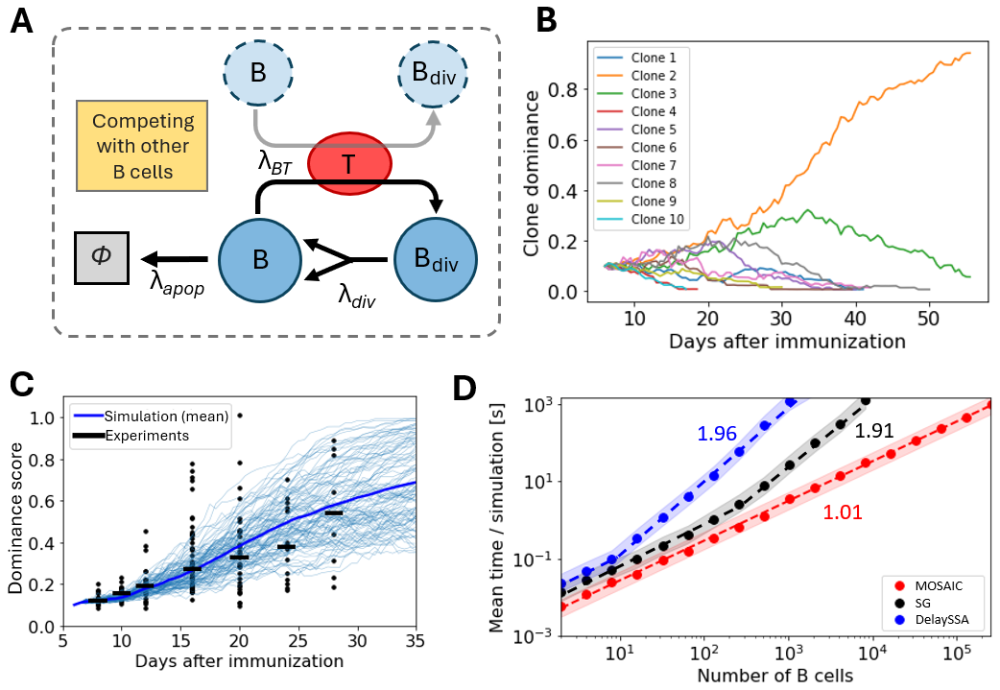

# Application 2: clonal B cell competition in germinal centers

<p align="center"></p>

B cells compete for a limited pool of T cells. Each B cell carries an individual
affinity that changes at division, and a T cell bound to a B cell can be captured by
another B cell of higher affinity (`[B1T] + B2 -> [B2T] + B1`). This is the
"individual properties" use case: the propensity of a reaction depends on agent-level
attributes that are updated by custom reaction functions.

| Script | Produces | Precomputed data | Flag to recompute |
|---|---|---|---|
| `Simulating_immune_response.py` | clone dominance over time (panel B) and dominance score against the AID-Confetti experiments of Tas et al. (2016) (panel C) | `GC_diversity.xlsx` (experimental data, Tas et al., *Science* 2016) | runs live (`Nsim` realisations) |
| `Benchmarking_Immune.py` | runtime vs. number of B cells for MOSAIC, SG and DelaySSA (panel D) | `time_MOSAIC.npy`, `time_Gil.npy`, `time_DSSA.npy` | `recompute = True` |

Run from this folder:

```bash
python Simulating_immune_response.py
```

The scripts use `lib_MOSAIC_with_rate_function.py`, a subclass of the core library
that draws the initial affinities and founder clones (`on_reinitialize`) and stores the
clone and affinity of every B cell at each recorded timepoint (`record_extra`). The
generic machinery lives in the core: `perform_reaction_custom` (a user function called
instead of the default bookkeeping, used here to transfer affinities and clone identity
to daughter cells), `r0_function` (state-dependent rates), the Pareto distribution and
`get_random_element(..., weights=...)` for weighted selection of reactants.

Per-cell attributes are stored in plain dictionaries attached to the simulation object
(`G_simul.Bcell_affinity`, `G_simul.Ancestor`) and keyed by the reactant UUID.
