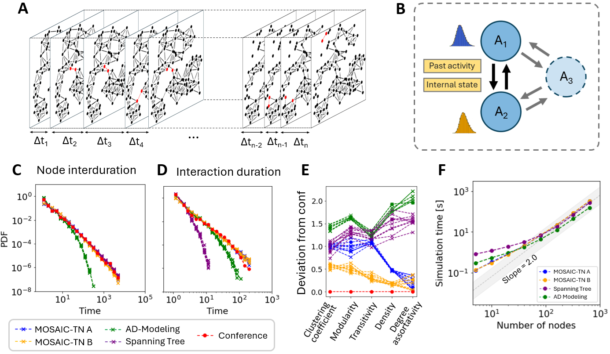

# Application 3: bursty human interactions in temporal networks (MOSAIC-TN)

<p align="center"></p>

Face-to-face interactions are simulated as reactions between agents
(`A_i + A_j -> [A_i A_j]`, `[A_i A_j] -> A_i + A_j`) with Pareto-distributed waiting
times. Agents keep a memory of past partners (first- and second-order acquaintances)
and, optionally, an individual activity level. The simulated networks are compared
with the SocioPatterns ICCSS17 conference dataset (`Conf17`) and with two baseline
generators, the activity-driven model (ADM) and a spanning-tree model.

## Setup

The network files are shipped as a single archive. Extract it once in this folder:

```bash
unzip Data.zip
```

This creates `Data/Networks/*.csv` (interaction lists `t i j`), the corresponding
precomputed observables `*.pkl`, and `Data/sim_time_*.npy` (runtime benchmarks).

## Scripts

| Script | Produces | Precomputed data | Flag to recompute |
|---|---|---|---|
| `Compare_networks.py` | node inter-duration, edge inter-duration and interaction duration distributions, and aggregated network metrics against the conference data (panels C, D, E) | `Data/Networks/*.pkl` | `recompute_observables = True` |
| `Benchmarking_time.py` | runtime vs. number of nodes for MOSAIC-TN A/B, spanning tree and ADM (panel F) | `Data/sim_time_*.npy` | `recompute = True` |
| `Plot_temporal_network.py` | interactive animation of the conference network snapshots (basis of panel A) | `Data/Networks/Conf17.csv` | runs live (stop with Ctrl-C) |

The shipped `*.pkl` observables predate the edge inter-duration metric. The first run
of `Compare_networks.py` computes it from the `.csv` files (about a second per network)
and stores it back into the pickles. Recomputing all observables from scratch
(`recompute_observables = True`) takes hours and optionally uses the `cdiversity`
package for the community diversity metric.

## Models

| File | Model |
|---|---|
| `lib_MOSAIC_IP_model.py` | MOSAIC-TN. `case='Basic'` is MOSAIC-TN A, `case='first_order'` is MOSAIC-TN B (memory of first-order acquaintances), `case='second_order'` adds friends of friends, `use_IP=True` adds individual activity levels. |
| `lib_Spanning_tree.py` | spanning-tree baseline (requires `numba`). |
| `lib_ADM.py` | activity-driven model baseline. The simulations were generated with [Didier Le Bail's code](https://github.com/DidierLeBail/Temporal-networks-PhD-code); only the precomputed results are included here. |

The network files `Sim_MOSAIC_Basic_*`, `Sim_MOSAIC_first_order_*` and `Sim_ADM_V9_*`
in `Data/Networks` are ten realisations of each model used for the comparison.

Data source: SocioPatterns, http://www.sociopatterns.org/ (ICCSS17 dataset, Génois
and Barrat, 2018).
