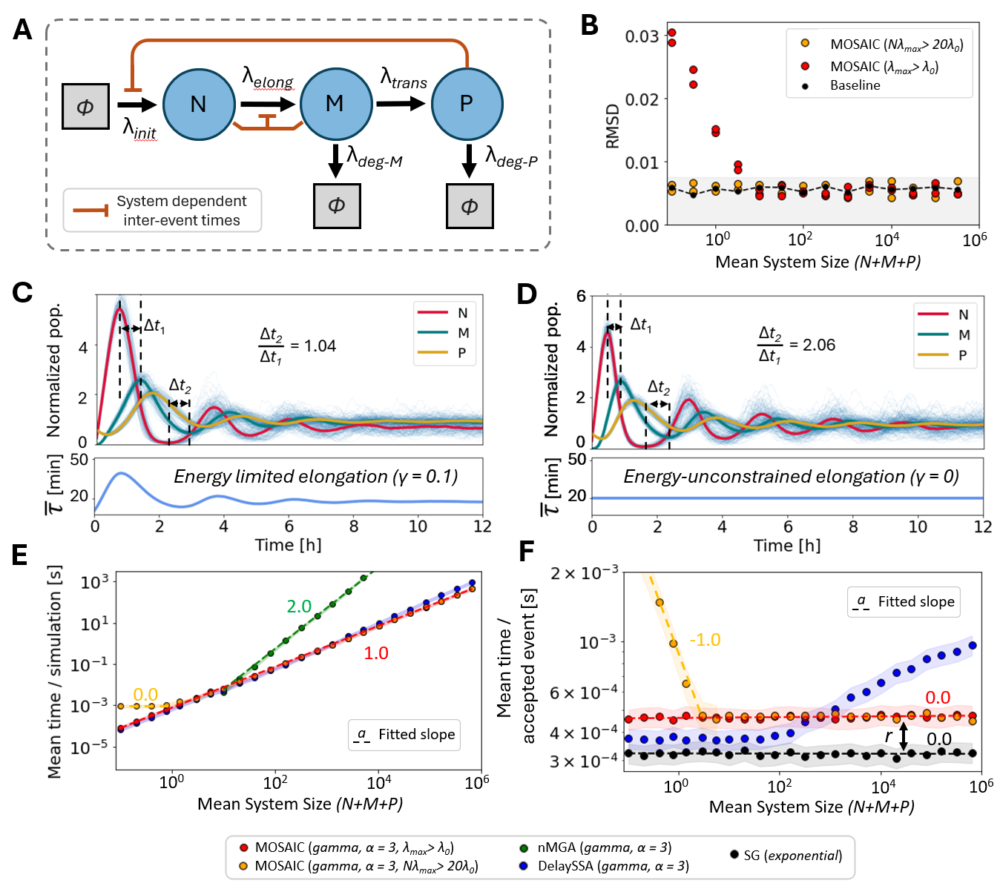

# MOSAIC: Scalable Stochastic Simulation with Heterogeneous and Non-Markovian Agents

[](https://doi.org/10.1038/s41467-026-69817-y)
[](https://arxiv.org/abs/2212.05059)
[](https://hal.science/hal-05763067)
[](LICENSE)


Discrete stochastic processes are widespread in nature and in human-made systems, from
biochemistry and immunology to epidemiology, social dynamics and finance. In most of
these systems the dynamics cannot be described with memoryless (Markovian) interactions,
and the agents are not interchangeable: each one carries its own state, history and
preferences.

**MOSAIC** is a Gillespie-type framework that simulates such systems exactly, with

- arbitrary inter-event time distributions (non-Markovian reactions),
- agent-specific rates and properties that can be updated by the reactions themselves,
- interaction preferences that evolve with the history of the system (temporal networks),

while keeping a computational cost close to that of the standard Gillespie algorithm.
The core of the method is a rejection-based scheme, originally published under the name
REGIR (*Rejection Gillespie for non-Markovian Reactions*), in which events are proposed
at an upper bound of the rate and accepted with the ratio between the true hazard and
that bound.

This repository contains the reference implementation and everything needed to reproduce
the results of the paper:

> Pélissier A., Phan M., Le Bail D., Beerenwinkel N., Rodríguez Martínez M.
> **Unifying non-Markovian dynamics and agent heterogeneity in scalable stochastic networks.**
> *Nature Communications* 17, 3345 (2026). https://doi.org/10.1038/s41467-026-69817-y

&nbsp;
## Scope of this repository

A general, pip-installable implementation of the non-Markovian Gillespie method
(rejection scheme, Laplace Gillespie and DelaySSA, eight waiting-time distributions) is
maintained separately as [NoMaSS](https://github.com/AI-SysBio/NoMaSS)
(`pip install nomass`). Use it to simulate your own reaction networks.

This repository is focused on the systems studied in the paper, in particular the two
features that are specific to MOSAIC: **agents with individual properties** (clonal
B cell competition) and **MOSAIC-TN**, the temporal network model with memory and
individual activity (bursty human interactions). It contains the code, the data and the
precomputed results needed to reproduce every figure.

## Setup

Python 3.9 or later. Clone the repository and install the dependencies:

```bash
git clone https://github.com/AI-SysBio/MOSAIC.git
cd MOSAIC
pip install -r requirements.txt
```

The core algorithm is the single file [`MOSAIC/MOSAIC.py`](MOSAIC/MOSAIC.py);
[`MOSAIC/Toy_example.py`](MOSAIC/Toy_example.py) shows the API on a small
three-species system and `pytest` runs a few smoke tests of the library.

## Reproducing the results of the paper

Each application lives in its own folder with a README describing the model, the
scripts, the precomputed data and the flags to regenerate it. Scripts are run from
their own folder and load precomputed results by default, so every figure can be
redrawn in seconds.

| Application | Folder | What it shows |
|---|---|---|
| Method scalability | [`MOSAIC/Benchmark`](MOSAIC/Benchmark) | runtime of MOSAIC vs. standard Gillespie, DelaySSA and the next-reaction method on simple systems |
| Transcription with heterogeneous delays | [`MOSAIC/Application_delay`](MOSAIC/Application_delay) | accuracy and cost on a Hes1-like feedback loop with gamma-distributed elongation and state-dependent rates |
| Clonal B cell competition | [`MOSAIC/Application_Immune_response`](MOSAIC/Application_Immune_response) | agents with individual affinities competing for T cell help, compared with germinal center experiments |
| Bursty human interactions (MOSAIC-TN) | [`MOSAIC/Application_Temporal_network`](MOSAIC/Application_Temporal_network) | temporal networks with memory and individual activity, compared with the SocioPatterns conference data and with the ADM and spanning-tree generators |

<p align="center">
  
  
  
</p>

The two application libraries (`lib_REGIR_with_delay.py`, `lib_REGIR_with_rate_function.py`)
are snapshots of the core library extended with the hooks each application needed
(Anderson scheme and Hes1 rate functions; custom reactions and Pareto waiting times).
They are kept as used for the paper so that the results can be reproduced exactly.

## Repository layout

```
MOSAIC/
├── MOSAIC.py                        core library (single file)
├── Toy_example.py                   quick-start script
├── Benchmark/                       scalability benchmarks on simple systems
├── Application_delay/               transcription with heterogeneous delays
├── Application_Immune_response/     clonal B cell competition (agent properties)
└── Application_Temporal_network/    MOSAIC-TN temporal networks
Figures/                             figures used in this README
tests/                               pytest smoke tests of the core library
```

## Citation

If you use MOSAIC, please cite:

```bibtex
@article{Pelissier2026MOSAIC,
  title   = {Unifying non-Markovian dynamics and agent heterogeneity in scalable stochastic networks},
  author  = {P{\'e}lissier, Aur{\'e}lien and Phan, Miroslav and Le Bail, Didier and Beerenwinkel, Niko and Rodr{\'i}guez Mart{\'i}nez, Mar{\'i}a},
  journal = {Nature Communications},
  volume  = {17},
  number  = {1},
  pages   = {3345},
  year    = {2026},
  doi     = {10.1038/s41467-026-69817-y}
}
```

Related work:

- The rejection algorithm was first described as REGIR in the preprint
  [arXiv:2212.05059](https://arxiv.org/abs/2212.05059).
- [NoMaSS](https://github.com/AI-SysBio/NoMaSS), the pip-installable library, is
  described in Pélissier A., Phan M., Beerenwinkel N., Rodríguez Martínez M.,
  *Gillespie-based simulation and inference for non-Markovian stochastic reaction networks*,
  Briefings in Bioinformatics 27(5), bbag486 (2026). https://doi.org/10.1093/bib/bbag486

## License

MIT, see [LICENSE](LICENSE).
