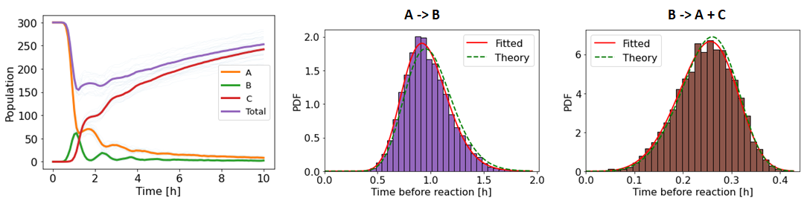

# MOSAIC: Scalable Stochastic Simulation with Heterogeneous and Non-Markovian Agents

[](https://doi.org/10.1038/s41467-026-69817-y)
[](https://arxiv.org/abs/2212.05059)
[](https://hal.science/hal-05763067)
[](LICENSE)


Discrete stochastic processes are widespread in nature and in human-made systems, from
biochemistry and immunology to epidemiology, social dynamics and finance. In most of
these systems the dynamics cannot be described with memoryless (Markovian) interactions,
and the agents are not interchangeable: each one carries its own state, history and
preferences.

**MOSAIC** is a Gillespie-type framework that simulates such systems exactly, with

- arbitrary inter-event time distributions (non-Markovian reactions),
- agent-specific rates and properties that can be updated by the reactions themselves,
- interaction preferences that evolve with the history of the system (temporal networks),

while keeping a computational cost close to that of the standard Gillespie algorithm.
The core of the method is a rejection-based scheme, originally published under the name
REGIR (*Rejection Gillespie for non-Markovian Reactions*), in which events are proposed
at an upper bound of the rate and accepted with the ratio between the true hazard and
that bound.

This repository contains the reference implementation and everything needed to reproduce
the results of the paper:

> Pélissier A., Phan M., Le Bail D., Beerenwinkel N., Rodríguez Martínez M.
> **Unifying non-Markovian dynamics and agent heterogeneity in scalable stochastic networks.**
> *Nature Communications* 17, 3345 (2026). https://doi.org/10.1038/s41467-026-69817-y

&nbsp;

## Which implementation should I use?

| | [NoMaSS](https://github.com/AI-SysBio/NoMaSS) (`pip install nomass`) | This repository |
|---|---|---|
| Purpose | Maintained library for everyday use | Reference code and reproducibility archive of the paper |
| Rejection method (MOSAIC / REGIR) | yes | yes |
| Laplace Gillespie and DelaySSA | yes | DelaySSA only (`precompute_delay=True`) |
| Agent-level properties and custom reactions | yes | yes (`Application_Immune_response`) |
| MOSAIC-TN (temporal networks with memory and activity) | no | yes (`Application_Temporal_network`) |
| Benchmarks and figures of the paper | partly (its own paper) | all three applications |

If you simply want to simulate a non-Markovian reaction network, start with NoMaSS. Use
this repository to reproduce the paper, to simulate temporal networks with MOSAIC-TN, or
as a compact single-file implementation to build on.

## Installation

The core library is the single file [`MOSAIC/MOSAIC.py`](MOSAIC/MOSAIC.py) and only needs
NumPy, SciPy, Matplotlib, seaborn and `sortedcontainers`. Python 3.9 or later is required.

```bash
git clone https://github.com/AI-SysBio/MOSAIC.git
cd MOSAIC
pip install -r requirements.txt
```

Check the installation by running the test suite or the toy example:

```bash
pytest
```

```bash
python MOSAIC/Toy_example.py
```

## Quick start

A system with three species, two non-Markovian channels and one bimolecular Poisson
channel (the full script is [`MOSAIC/Toy_example.py`](MOSAIC/Toy_example.py)):

```python
import MOSAIC as mosaic

# Simulation parameters
class param:
    Tend = 10             # length of the simulation
    N_simulations = 20    # results are averaged over this many realisations
    unit = 'h'            # unit of time (plots only)
    timepoints = 100      # number of recorded timepoints (plots only)

# Reaction channels: rate = 1/mean inter-event time, shape_param sets the dispersion
reaction1 = mosaic.Reaction_channel(param, rate=1, shape_param=20, distribution='Gamma', name='A -> B')
reaction1.reactants = ['A']
reaction1.products = ['B']

reaction2 = mosaic.Reaction_channel(param, rate=4, shape_param=5, distribution='Weibull', name='B -> C + A')
reaction2.reactants = ['B']
reaction2.products = ['C', 'A']

reaction3 = mosaic.Reaction_channel(param, rate=0.03, name='A + B -> 0')   # two reactants: Poisson process
reaction3.reactants = ['A', 'B']
reaction3.products = []

# Initial population and simulation
N_init = {'A': 300, 'B': 0, 'C': 0}
G_simul = mosaic.Gillespie_simulation(N_init, param)
G_simul.reaction_channel_list = [reaction1, reaction2, reaction3]
populations = G_simul.run_simulations(param.Tend, verbose=True, seed=0)
# populations has shape (N_simulations, timepoints, n_species + 1); the last column is the total

G_simul.plot_inter_event_time_distribution()
G_simul.plot_populations()
```

The run takes a few seconds and produces the figures below (pass `verbose=False` to
silence the progress output):

<p align="center">
  
</p>

The oscillations caused by the non-Markovian dynamics are clearly visible. The
*theoretical* and *simulated* inter-event time distributions do not match exactly, even
with many realisations, because A and B are reactants of two channels at the same time.
The theoretical curve is the distribution a channel would have if it were the only
process acting on that reactant. This is expected in non-Markovian systems; the accuracy
of the method itself is characterised in the paper and in [`MOSAIC/Benchmark`](MOSAIC/Benchmark).

## Implemented distributions

Every channel is parameterised by a `rate` and a dimensionless `shape_param`:

| `distribution` | `rate` | `shape_param` | Notes |
|---|---|---|---|
| `Exponential` | 1/mean | ignored | Markovian (standard Gillespie) |
| `Gamma` | 1/mean | α (shape) | α < 1 requires `precompute_delay=True` |
| `Weibull` | 1/mean | k (shape) | k < 1 requires `precompute_delay=True` |
| `Normal` | 1/mean | std/mean | |
| `LogNormal` | 1/mean | std/mean | |
| `Cauchy` | 1/median | γ (scale) | |
| `Pareto` | 1/mean | α (tail index) | application libraries only (immune response, temporal networks) |

Non-Markovian waiting times are defined for channels with exactly one reactant, since
the inter-event time of a channel with several reactants is ambiguous. Channels with
zero or several reactants are simulated as Poisson processes.

Useful options of `Reaction_channel`:

- `precompute_delay=True` draws the waiting time of each agent when it is created and
  stores it in a sorted queue (the DelaySSA scheme). It is exact for any distribution,
  including those with a diverging hazard at t = 0, at the cost of O(N log N) scaling.
- `transfer_identity=True` keeps the identity (and the internal clock) of a reactant that
  also appears among the products, for example `M -> M + P`.
- `min_ratio` (argument of `Gillespie_simulation`) controls the accuracy of the
  rejection step: the proposal rate is kept at least `min_ratio` times larger than the
  rate of the slowest channel (see the paper for the error bound).

Agent-level properties, state-dependent rates (`r0_function`) and custom reaction
functions (`perform_reaction_custom`) are implemented in
[`Application_Immune_response/lib_REGIR_with_rate_function.py`](MOSAIC/Application_Immune_response/lib_REGIR_with_rate_function.py)
and documented in that folder.

## Reproducing the results of the paper

Each application lives in its own folder with a README describing the model, the
scripts, the precomputed data and the flags to regenerate it. Scripts are run from
their own folder and load precomputed results by default, so every figure can be
redrawn in seconds.

| Application | Folder | What it shows |
|---|---|---|
| Method scalability | [`MOSAIC/Benchmark`](MOSAIC/Benchmark) | runtime of MOSAIC vs. standard Gillespie, DelaySSA and the next-reaction method on simple systems |
| Transcription with heterogeneous delays | [`MOSAIC/Application_delay`](MOSAIC/Application_delay) | accuracy and cost on a Hes1-like feedback loop with gamma-distributed elongation and state-dependent rates |
| Clonal B cell competition | [`MOSAIC/Application_Immune_response`](MOSAIC/Application_Immune_response) | agents with individual affinities competing for T cell help, compared with germinal center experiments |
| Bursty human interactions (MOSAIC-TN) | [`MOSAIC/Application_Temporal_network`](MOSAIC/Application_Temporal_network) | temporal networks with memory and individual activity, compared with the SocioPatterns conference data and with the ADM and spanning-tree generators |

<p align="center">
  
  
  
</p>

The two application libraries (`lib_REGIR_with_delay.py`, `lib_REGIR_with_rate_function.py`)
are snapshots of the core library extended with the hooks each application needed
(Anderson scheme and Hes1 rate functions; custom reactions and Pareto waiting times).
They are kept as used for the paper so that the results can be reproduced exactly.

## Repository layout

```
MOSAIC/
├── MOSAIC.py                        core library (single file)
├── Toy_example.py                   quick-start script
├── Benchmark/                       scalability benchmarks on simple systems
├── Application_delay/               transcription with heterogeneous delays
├── Application_Immune_response/     clonal B cell competition (agent properties)
└── Application_Temporal_network/    MOSAIC-TN temporal networks
Figures/                             figures used in this README
tests/                               pytest smoke tests of the core library
```

## Citation

If you use MOSAIC, please cite:

```bibtex
@article{Pelissier2026MOSAIC,
  title   = {Unifying non-Markovian dynamics and agent heterogeneity in scalable stochastic networks},
  author  = {P{\'e}lissier, Aur{\'e}lien and Phan, Miroslav and Le Bail, Didier and Beerenwinkel, Niko and Rodr{\'i}guez Mart{\'i}nez, Mar{\'i}a},
  journal = {Nature Communications},
  volume  = {17},
  number  = {1},
  pages   = {3345},
  year    = {2026},
  doi     = {10.1038/s41467-026-69817-y}
}
```

Related work:

- The rejection algorithm was first described as REGIR in the preprint
  [arXiv:2212.05059](https://arxiv.org/abs/2212.05059).
- [NoMaSS](https://github.com/AI-SysBio/NoMaSS), the pip-installable library, is
  described in Pélissier A., Phan M., Beerenwinkel N., Rodríguez Martínez M.,
  *Gillespie-based simulation and inference for non-Markovian stochastic reaction networks*,
  Briefings in Bioinformatics 27(5), bbag486 (2026). https://doi.org/10.1093/bib/bbag486

## License

MIT, see [LICENSE](LICENSE).
